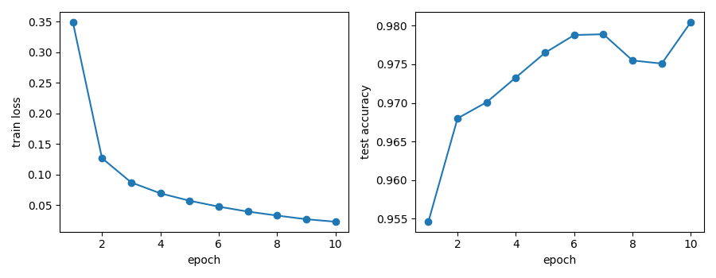

# numpy-nn

只用 numpy 手写的两层神经网络，做 MNIST 手写数字分类。前向、反向传播、数值梯度检查、训练循环都是手敲的。

## 网络结构（N 是一批的样本数）

| 层 | 计算 | 输出 shape |
|---|---|---|
| 输入 | `images` | (N, 784) |
| 第一层 | `pre_relu = images @ weight1 + bias1` | (N, 128) |
| relu | `hidden = relu(pre_relu)` | (N, 128) |
| 第二层 | `logits = hidden @ weight2 + bias2` | (N, 10) |
| softmax | `probs = softmax(logits)` | (N, 10) |
| 交叉熵 | `loss = cross_entropy(probs, labels)` | 一个数 |

## 反向传播（手推）

| 梯度 | 写法 | shape |
|---|---|---|
| `grad_logits` | `(probs - onehot) / N` | (N, 10) |
| `grad_weight2` | `hidden.T@grad_logits` | (128,10) |
| `grad_bias2` | `grad_logits.sum(axis=0)` | (10,) |
| `grad_hidden` | `grad_logits@weight2.T` | (N, 128) |
| `grad_pre_relu` | `grad_hidden*(pre_relu>0)` | (N, 128) |
| `grad_weight1` | `images.T@grad_pre_relu` | (784,128) |
| `grad_bias1` | `grad_pre_relu.sum(axis=0)` | (128,) |

## 数值梯度检查

`08_grad_check.py`：4 个样本、6 个特征、5 个隐藏单元、3 类，四个参数逐格比对。把每个参数挪动 ±eps，用 loss 的变化算出数值梯度，再和 `backward` 的结果用 `np.allclose` 比较，四个参数全部是 True。

它拦下过两种错，这两种错 loss 照样会下降，shape 也完全对：

- relu 反向没有清零：`weight1`、`bias1` 两项是 False
- `grad_hidden` 乘成了 `grad_weight2.T`（应为 `weight2.T`）：两者 shape 相同，shape assert 拦不住，同样是 `weight1`、`bias1` 两项是 False

它拦不住的：测试数据本身写错了（比如 `randn` 写成 `rand`），四个 True 照样会过，只能靠核对期待值发现。

## 训练结果

mini-batch SGD：batch 100，学习率 0.5，10 个 epoch，隐藏层 128（`09_train.py`）。

| seed | 测试集准确率 |
|---|---|
| 0 | 0.9805 |
| 1 | 0.9774 |
| 2 | 0.9778 |

我把隐藏层去掉，只用 softmax(images @ weight + bias) 进行分类。在相同的训练设置下，单层模型的测试准确率是 92.21%，训练损失降到 0.27 左右后基本稳定。

两层网络的准确率达到了 98.05%，错误率从单层的约 7.8% 降到约 2%，相当于错误减少了四分之三。

## 遇到的 bug 和怎么发现的

### ① 10/28　练习改动被带进了提交

01 第 7 行没有恢复成 784 → 提交时把练习用的错误代码一起存进了仓库 → 10/29 开工复查时发现，通过提交 423b5da 修正。

这次漏掉的是恢复后的验证。故意改错的练习，要做到修改、运行、恢复、再次运行，提交前还要看一遍 git diff。

### ② 10/29　梯度的分母用错了

grad_logits 应除以样本数 100，实际除以了类别数 10 → 更新一步后，错误版本的 loss 下降幅度反而更大 → 对照公式可以看出，算出的梯度被放大了 10 倍。

在普通梯度下降中，这相当于把学习率放大了 10 倍。下降幅度只能反映这一步的效果，梯度是否算对还需要单独验证。

### ③ 10/30　ReLU 没有截断应当归零的梯度

反向传播中的 `(pre_relu > 0)` 掩码没有生效 → 07 的单步更新仍能让 loss 下降 → 到 08 做数值梯度检查时，`weight1` 和 `bias1` 两项出现 False。

被 ReLU 关闭的单元仍然传回了梯度。这个错误在整体 loss 的变化中不明显，但逐个检查参数梯度时暴露了出来。

### ④ 10/31　测试数据的生成方式写错了

08 第 5 行把 `randn` 写成了 `rand` → 四项梯度检查全部通过，但首个输出变成了 1.0986560104729493，与预期的 1.0987214335908604 不同 → 逐项核对预期输出时发现异常，定位到了随机数据生成语句。

四个 True 只能说明当前数据下两种梯度计算相符。测试数据的分布已经改变，仍需通过输入检查和预期输出核对来发现。

### ⑤ 11/1　图片和标签使用了不同的取样顺序

图片按打乱后的 batch 索引读取，标签却仍按连续区间切片 → loss 长期停在约 2.30，准确率只有 0.1028，最终断言失败 → 对照图片和标签的取样语句，可以定位到两者索引不一致。

数组形状虽然匹配，训练样本的对应关系已经错位。修正时应让图片和标签共用同一组索引。接近随机猜测的结果值得检查数据配对，但仅凭准确率，还不能确定模型是否始终预测同一类别。

## PyTorch 替我做掉了什么

| PyTorch | numpy 版里对应的（文件、哪几行） | 我怎么验证的（文件、结果） |
|---|---|---|
| `nn.Linear` | `model.py` 第 23、25 行的 `images@weight1+bias1`、`hidden@weight2+bias2`，参数也由它自己存。numpy 版权重存成（输入，输出），PyTorch 存成（输出，输入），计算时转置 | `14`：`layer(images_t)` 和手写的 `images_t @ layer.weight.T + layer.bias` 比较，打出 True |
| `F.cross_entropy` | `model.py` 第 3–10 行的 `softmax` 和 `cross_entropy`：减最大值、exp、归一化、按标签取概率、取 log、求平均 | `13`：loss 是 `1.0987214335908604`，和 numpy 版一样 |
| `loss_t.backward()` | `model.py` 的 `backward`，第 33–39 行，7 行手推的梯度 | `13`：四个梯度和 numpy 版比较，四个 True |
| `optimizer.step()` | `09` 第 32–35 行，`weight1 = weight1 - lr * grad_weight1` 那四行 | `15`：前三步 loss 和 numpy 版一样；`16`：十个 epoch 的准确率和 `09` 逐位一样 |
| `optimizer.zero_grad()` | numpy 版没有对应的行：`backward` 每次返回新算的梯度。autograd 是把梯度累加到 `.grad` 上，所以每步要先清零 | `15` 里去掉它：第三步 loss 变成 `1.0540`，不是 `1.0664` |
| `DataLoader(shuffle=True)` | `09` 第 21 行每个 epoch 开头的 `np.random.permutation`，加上按 batch 切片 | `17`：打乱两次，五个标签都在、图和标签没拆开；`18`（`shuffle=False`）：十个 epoch 的准确率和 numpy 算出的期待逐位一样 |